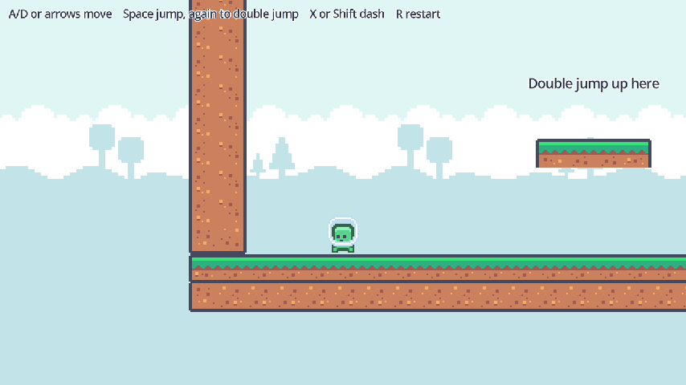
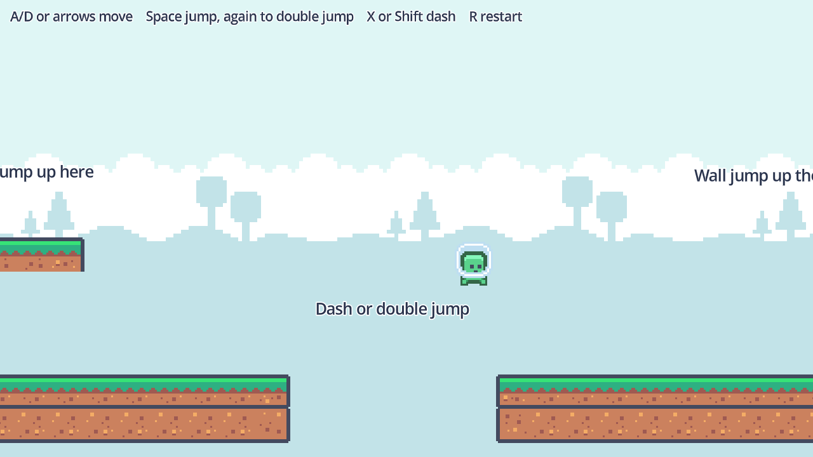

# Godot Platformer Controller

A 2D platformer player controller for Godot 4: coyote time, jump buffering,
variable jump height, double jump, air dash, wall slide and wall jump, in one
script with every number exposed in the Inspector.



## Features

- **Running with weight.** Acceleration and friction instead of instant speed,
  with a little less control in the air.
- **Coyote time.** You can still jump for a moment after running off a ledge.
- **Jump buffering.** A jump pressed just before you land fires on touchdown.
- **Variable jump height.** Tap for a hop, hold for a full jump.
- **Jump arc tuning.** Lighter gravity going up, heavier coming down, a floaty
  apex, and a capped fall speed.
- **Double jump.** One extra jump in the air, refilled when you land. Set
  `max_air_jumps` to 2 for a triple jump.
- **Air dash.** A short, flat burst with a cooldown, once per airtime.
- **Wall slide and wall jump.** Hold into a wall to slide down slowly, press jump
  to kick off it. A wall jump gives back your double jump and your dash, so the
  moves chain.
- **One script, no plugins.** `scripts/player.gd` is the whole controller, about
  230 lines with comments.

## Demo



The test level has one spot for each move: a platform a normal jump cannot reach
(double jump), a gap a running jump falls short of (dash or double jump), and a
narrow shaft with a cliff at the top (wall jump from side to side). Fall into the
gap and you are put back at the start.

## Requirements

- Godot **4.7** or later, standard build (GDScript only, no .NET needed).
- Tested on **Godot 4.7.2 stable** on Windows. The controller script uses nothing
  newer than Godot 4.0, but earlier versions are untested.
- Uses the Compatibility renderer, so it runs on older GPUs too.

## Installation

Clone the repository:

```bash
git clone https://github.com/CodingQuests/godot-platformer-controller.git
```

Or download it with **Code > Download ZIP** and unzip it.

Then open Godot, click **Import**, pick the `project.godot` file inside the folder,
and click **Import & Edit**.

## Quick Start

1. Press **F5**.
2. Run with **A** and **D** or the arrow keys.
3. Jump with **Space**, **W** or **Up**. Press it again in the air to double jump
   onto the high platform.
4. Dash with **X** or **Shift**. Jump the gap and dash at the top of the jump.
5. In the shaft, jump into a wall and press jump again to kick off it. Go from
   side to side to reach the flag.
6. Press **R** to go back to the start.

## How It Works

### One velocity, in a fixed order

Every move changes the same `velocity`, and the order they run in each physics
frame decides who wins (animation calls left out here):

```gdscript
func _physics_process(delta):
	_tick_dash(delta)          # a dash overrides everything while it lasts
	if is_dashing:
		move_and_slide()
		return

	_apply_gravity(delta)      # lighter rising, heavier falling, floaty apex
	_handle_wall_slide(delta)  # cap the fall speed while hugging a wall
	_handle_jump(delta)        # wall jump > ground jump > double jump
	_handle_horizontal(delta)  # run, unless a wall jump just locked steering
	_try_start_dash()
	move_and_slide()
```

### Forgiveness timers

Two timers make the controls feel generous:

- `coyote_timer` is refilled while you stand on the floor and counts down once
  you leave it. A jump is allowed while it is above zero, so a press a few frames
  after you run off a ledge still counts as a ground jump.
- `jump_buffer_timer` is set when you press jump and counts down. Any frame where
  a jump becomes possible while it is above zero, the jump happens, so a press a
  few frames before you land is not lost.

### The jump chain

A buffered press becomes exactly one kind of jump, in priority order (timer
resets left out here):

```gdscript
if jump_buffer_timer > 0.0 and is_on_wall_only() and not is_on_floor():
	_do_wall_jump()                      # 1. touching a wall in the air
elif jump_buffer_timer > 0.0 and coyote_timer > 0.0:
	velocity.y = jump_velocity           # 2. on the floor, or just left it
elif jump_buffer_timer > 0.0 and air_jumps_left > 0:
	velocity.y = double_jump_velocity    # 3. spend an air jump
	air_jumps_left -= 1
```

Letting go of jump while still rising multiplies the upward speed by `jump_cut`,
which is the whole of variable jump height.

### Dash

A dash sets `is_dashing` and a timer. While it lasts, the dash owns the velocity:
`dash_speed` sideways, zero vertical, no gravity and no steering. You get one dash
per airtime (`can_dash` refills on the floor or on a wall jump) and a cooldown
between dashes.

### Wall slide and wall jump

In the air, touching a wall and holding toward it caps your fall at
`wall_slide_speed`. A jump while touching the wall pushes you away along
`get_wall_normal()` and up, then ignores steering for `wall_jump_lock` seconds so
the kick is not cancelled by the key you are still holding.

## Project Structure

```
project.godot                     Project file, input actions, window size
scripts/player.gd                 The controller
scenes/Player.tscn                The player: CharacterBody2D, sprite, collision
Main.tscn                         Demo only: the test level, camera, signs
scripts/main.gd                   Demo only: follow camera, restart, fall reset
scripts/tiled_block.gd            Demo only: draws a block of ground tiles
assets/kenney_pixel-platformer/   Kenney Pixel Platformer art (CC0) and its license
```

## Using It In Your Own Game

1. Copy `scripts/player.gd` and `scenes/Player.tscn` into your project, or attach
   `player.gd` to your own `CharacterBody2D`.
2. Give the body a child named `AnimatedSprite2D` with these animations: `idle`,
   `run`, `jump`, `fall`, `double_jump` and `wall_jump`. They can share frames.
3. Add four input actions in **Project > Project Settings > Input Map**:
   `move_left`, `move_right`, `jump` and `dash`.
4. Put your level on physics layer 1. The player sits on layer 2 and collides with
   layer 1.
5. Tune the numbers in the Inspector. They are grouped under Run, Jump, Dash, Wall,
   Forgiveness and Gravity, and you can change them while the game runs.

## Customizing It

| Group | Property | Default | What it does |
|---|---|---|---|
| Run | `speed` | 130 | Top running speed, pixels per second |
| Run | `acceleration` | 1300 | How fast you reach top speed (70% of this in the air) |
| Run | `friction` | 1600 | How fast you stop when you let go |
| Jump | `jump_velocity` | -300 | Upward speed of a ground jump (negative is up) |
| Jump | `double_jump_velocity` | -260 | Upward speed of an air jump |
| Jump | `jump_cut` | 0.45 | Share of upward speed kept when you let go early |
| Jump | `max_air_jumps` | 1 | Extra jumps in the air; 0 turns the double jump off |
| Dash | `dash_speed` | 340 | Speed during a dash |
| Dash | `dash_duration` | 0.14 | Length of a dash, seconds |
| Dash | `dash_cooldown` | 0.35 | Wait between dashes, seconds |
| Wall | `wall_slide_speed` | 55 | Fall speed while sliding down a wall |
| Wall | `wall_jump_velocity` | -300 | Upward speed of a wall jump |
| Wall | `wall_jump_push` | 170 | Sideways speed away from the wall |
| Wall | `wall_jump_lock` | 0.12 | Seconds of ignored steering after a wall jump |
| Forgiveness | `coyote_time` | 0.10 | Seconds you can still jump after leaving a ledge |
| Forgiveness | `jump_buffer` | 0.10 | Seconds a jump press is remembered |
| Gravity | `rise_gravity_mult` | 0.9 | Gravity while going up |
| Gravity | `fall_gravity_mult` | 1.5 | Gravity while coming down |
| Gravity | `max_fall_speed` | 400 | Fastest fall speed |
| Gravity | `apex_speed_threshold` | 45 | Below this vertical speed you are "at the top" of a jump |
| Gravity | `apex_gravity_mult` | 0.55 | Extra gravity multiplier at the top, for a little hang time |

Base gravity comes from **Project Settings > Physics > 2D > Default Gravity**.

## Known Limitations

- The dash is horizontal only. There is no up or diagonal dash.
- No ledge grab, crouch, or dropping through one-way platforms.
- A wall slide needs you to hold toward the wall. A wall jump works on any wall
  you touch in the air.
- Air control (70% of `acceleration`) and the double jump animation time are
  fixed in the script, not exported.
- Slopes use the default `CharacterBody2D` floor settings and are not tuned.
- The demo character has two frames, so several animations share them.
- Tested on Godot 4.7.2 on Windows only.

## License

MIT for the code. See [LICENSE](LICENSE).

## Third-Party Assets

The character, ground tiles, flag and background are from
[Pixel Platformer](https://kenney.nl/assets/pixel-platformer) by Kenney, released
under CC0 1.0. Details in [THIRD_PARTY_ASSETS.md](THIRD_PARTY_ASSETS.md), and the
pack's original license is in `assets/kenney_pixel-platformer/License.txt`.

## Learn How It Works

Want to understand how this works instead of just copying it?

CodingQuests teaches you how to build systems like this step by step in Godot,
with interactive lessons and real projects.

- **[Move & Jump](https://codingquests.io/quests/platformer-move-jump?utm_source=github&utm_medium=resource&utm_campaign=godot_platformer_controller)**
  builds the base: a `CharacterBody2D` with gravity, running with acceleration
  and friction, a jump, and animation swapping. Free, 3 lessons.
- **[A Jump That Feels Amazing](https://codingquests.io/quests/platformer-game-feel?utm_source=github&utm_medium=resource&utm_campaign=godot_platformer_controller)**
  adds coyote time, jump buffering, variable jump height and the gravity tuning.
  Free, 3 lessons.
- **[Dash, Double Jump & Wall Jump](https://codingquests.io/quests/platformer-moveset?utm_source=github&utm_medium=resource&utm_campaign=godot_platformer_controller)**
  adds the double jump, the air dash with its cooldown, and the wall slide and
  wall jump. The first lesson is free.

Made by [CodingQuests](https://codingquests.io/?utm_source=github&utm_medium=resource&utm_campaign=godot_platformer_controller).
